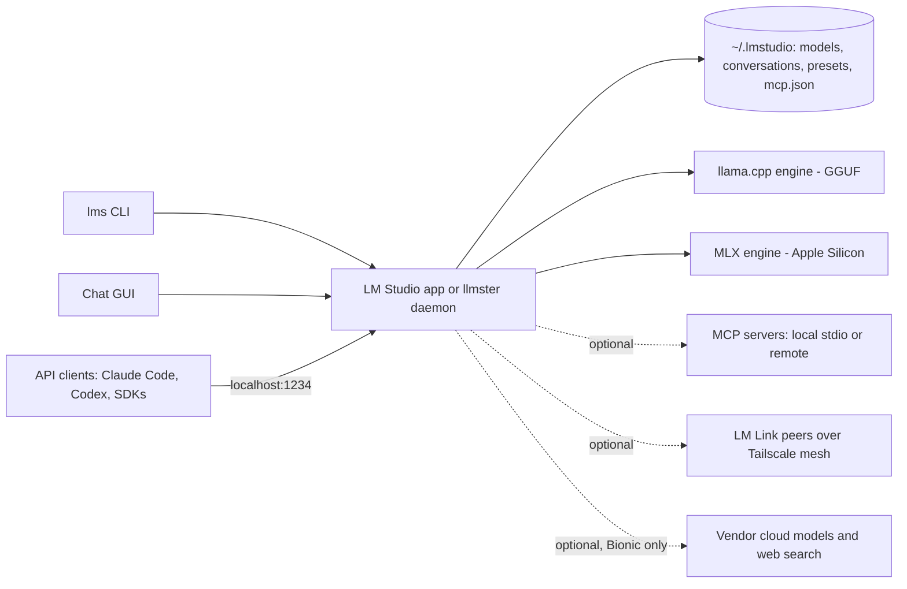
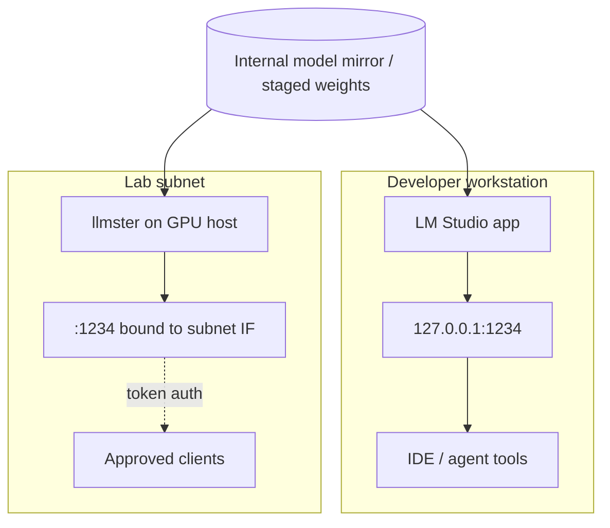

---
# ─── Identity ───────────────────────────────────────────────
type: product-research
product: "LM Studio"
vendor: "Element Labs, Inc."
aliases: ["LM Studio", "lms", "llmster", "Bionic", "LM Link"]
url: "https://lmstudio.ai"
docs: "https://lmstudio.ai/docs"
repo: "https://github.com/lmstudio-ai"   # CLI/SDKs/MLX engine only — the app itself is closed source

# ─── Classification ─────────────────────────────────────────
category: "local-llm-runtime"
deployment: "self-hosted (desktop app + headless daemon); optional vendor cloud for Bionic"
license: "proprietary (SDKs, CLI and MLX engine are MIT)"
pricing-model: "free for the local app; per-seat subscription for Bionic cloud inference"

# ─── Assessment ─────────────────────────────────────────────
status: "researching"
verdict: "trial"
confidence: "medium"
maturity: "ga"

# ─── Provenance ─────────────────────────────────────────────
researched: 2026-09-13
updated: 2026-09-13
version-reviewed: "LM Studio 0.4.24 (Sep 9, 2026); Bionic 1.1.2 (Sep 8, 2026)"
researcher: "agent"

tags: [research/product, category/local-llm-runtime, status/researching, verdict/trial]
---

# Element Labs — LM Studio

> [!abstract] One-liner
> A closed-source desktop app plus headless daemon that downloads, loads and serves open-weight LLMs on your own hardware behind an OpenAI- and Anthropic-compatible localhost API.

## Summary

- **What:** The most polished on-ramp to running open-weight models locally. One installer gets you model discovery from Hugging Face, a chat UI, GGUF (llama.cpp) and MLX runtimes, a local HTTP server, an MCP host, and a CLI.
- **How it works:** Everything runs on the machine. Model weights land in `~/.lmstudio/models`; inference happens in a bundled engine; an optional server on `localhost:1234` speaks OpenAI `/v1/*`, Anthropic `/v1/messages`, and a first-party `/api/v1/*`. Since 0.4.0 the core is separable from the GUI as a daemon (`llmster`) that runs on Linux servers and in CI.
- **Why it matters here:** It is the fastest way to give an engineer a private model endpoint that Claude Code, Codex, Continue and similar tools can point at unchanged — useful for offline agent testing and for evaluating open-weight models without sending anything to a vendor. It is **not** a shared-inference platform.
- **Effort to adopt:** Hours for an individual workstation. Weeks-to-never for anything governed: there is no SSO, no SCIM, no central policy, no fleet management, no audit export, and no published security attestation.
- **Verdict:** **Trial** on individual workstations and a lab box. **Hold** on anything resembling a shared or production inference tier — vLLM or a managed endpoint fits that shape far better.

## What It Is

LM Studio is a desktop application for discovering, downloading, configuring and running open-weight language models on local hardware. It sits in the "local LLM runner" category alongside Ollama, Jan, GPT4All and llama.cpp's own `llama-server`, and has generally been the GUI-first option in that set. The vendor is Element Labs, Inc., a Delaware corporation; the product has been in active development since 2023 and is well past early-access — release cadence is roughly weekly.

As of this research the product line has split in two, which matters more than it first appears:

1. **LM Studio** (version **0.4.24**, Sep 9 2026) — the model runner. Desktop app, `llmster` daemon, `lms` CLI, local API server. This is the thing worth evaluating as infrastructure.
2. **Bionic** (version **1.1.2**, Sep 8 2026) — an agent product layered on the same runtime, aimed at coding and document work, with projects, skills, subagents, shell execution and voice transcription. Bionic is now what `lmstudio.ai` markets on its front page, and it is what the **Pricing** page prices. Bionic optionally calls vendor-hosted frontier open models in the cloud.

The edition researched here is the **free local tier**: the desktop app and `llmster`, running local models only, with no account signed in. That configuration is genuinely offline-capable. Once Bionic cloud models, web search, or LM Link are enabled, the boundary changes and the note's Security section no longer describes what you are running.

Licensing is proprietary. The app and daemon are closed-source binaries; the desktop Terms of Service grant a non-exclusive, non-transferable licence to use the software for <span>"personal and / or internal business purposes"</span> — so ordinary corporate use is permitted without a paid tier, but reselling it, wrapping it as a service, or running it as a service bureau is explicitly not. The CLI (`lms`), both SDKs, the MLX engine and `venvstacks` are published on GitHub under MIT; the application itself is not.

## Problem It Solves

Without something like this, "let me try that model" costs an afternoon: locate weights, pick a quantization, build or fetch an inference engine, wire up a prompt template, expose an endpoint. LM Studio compresses that to a search box and a load button, and — crucially — the result speaks the same API shape as the commercial providers, so existing client code, agent frameworks and IDE extensions work by changing a base URL.

Who feels the pain: engineers evaluating open-weight models; anyone who needs to test an agent loop without a per-token bill; teams working with material that cannot leave the machine; developers on aircraft, in labs, or behind restrictive egress rules.

Realistic alternatives include doing nothing (use hosted APIs and accept the data-handling review), Ollama (CLI-first, same llama.cpp lineage), raw `llama-server`, or a managed endpoint such as Bedrock. The honest framing is that LM Studio competes on *ergonomics for one person*, not on serving characteristics.

## How It Works

### Architecture

There is no control plane. Everything below runs on the user's machine; the only outbound calls in the local-only configuration are model search and download (to the vendor catalog and Hugging Face) and the app update check.



Model weights, chat history, presets and `mcp.json` all live under `~/.lmstudio/` (`%USERPROFILE%\.lmstudio` on Windows) as plain files. Conversations are JSON on disk. There is no server-side state and no vendor-held copy of any of it.

Runtimes are versioned and swappable independently of the app — the changelog tracks llama.cpp engine packs (2.33.0 as of Bionic 1.1.2) separately from app releases, and `lms runtime update llama.cpp` pulls a new one without an app upgrade. On Apple Silicon, MLX is a second engine with its own capabilities and gaps (continuous batching landed in llama.cpp first).

### Core Concepts

| Term | Means | Notes |
|---|---|---|
| **LM Studio** | The GUI desktop app | Full feature surface; easiest entry point |
| **llmster** | The same core packaged as a headless daemon | Introduced in 0.4.0; installs via a shell one-liner; `lms daemon up` starts it. This is the server story. |
| **lms** | The CLI | Talks to either the app or the daemon; ships with both; MIT-licensed on GitHub |
| **Bionic** | The agentic product built on the runtime | Projects, skills, subagents, shell execution, document creation; separate versioning |
| **LM Link** | Use a model loaded on another of your machines as if it were local | Built on Tailscale mesh VPN; free tier limited to 5 devices |
| **LM Runtime / engine pack** | Versioned inference engine (llama.cpp or MLX) | Updated independently of the app |
| **JIT loading** | Load a model into memory on first API request | On by default; pairs with idle TTL and auto-evict |
| **Idle TTL** | Auto-unload a model after inactivity | Settable per request (`ttl`) or per load (`lms load --ttl`) |
| **Permission key / API token** | Bearer token gating the local API | Named tokens with per-token permissions; required for API access to `mcp.json` servers |
| **Preset** | Saved system prompt + inference parameters | Stored in `~/.lmstudio/config-presets` |

### Data Flow

One inference request, end to end, in the local-only configuration:

1. A client POSTs to `http://localhost:1234/v1/chat/completions` (or `/v1/messages`, or `/api/v1/chat`).
2. If **Require Authentication** is on, the server validates the bearer token and its permissions; otherwise it accepts the request unauthenticated. **Unauthenticated is the default.**
3. If the named model is not resident and JIT loading is on, the daemon loads it from disk into RAM/VRAM.
4. The engine applies the model's chat template and generates. With continuous batching (llama.cpp, default 4 parallel slots), concurrent requests are processed rather than queued.
5. The response returns with per-request stats (tokens/sec, time to first token). `/api/v1/chat` is stateful — it returns a `response_id` you can pass back as `previous_response_id`, meaning conversation state is held by the daemon, not the client.
6. The model stays resident until its idle TTL expires or auto-evict displaces it.

No trust boundary is crossed in that path. Boundaries **are** crossed when: searching or downloading models (queries reach the vendor and Hugging Face); the updater checks in (app version, OS, IP via CDN); a remote MCP server is called; LM Link is enabled (device list is uploaded for peer discovery, though traffic itself is end-to-end encrypted between your own machines); or Bionic cloud models and web search are used (transient processing, vendor states zero data retention throughout).

### Integration Surface

All first-party and supported:

- **OpenAI compatibility:** `/v1/chat/completions`, `/v1/completions`, `/v1/embeddings`, `/v1/models`, `/v1/responses`. Structured output via `response_format` JSON schema; tool/function calling via `tools`.
- **Anthropic compatibility:** `/v1/messages`. This is why Claude Code can be pointed at a local model.
- **First-party REST:** `/api/v1/chat` (stateful, supports MCP `integrations`), `/api/v1/models`, `/api/v1/models/load`, `/api/v1/models/unload`, `/api/v1/models/download` + download status. An older `/api/v0/*` surface remains for richer model metadata and stats.
- **SDKs:** `lmstudio-python` (PyPI: `lmstudio`) and `lmstudio-js` (`@lmstudio/sdk`), both MIT.
- **MCP:** the app is an MCP **host** — local (stdio) and remote servers configured in `mcp.json` using Cursor's notation, installable via `lmstudio://add_mcp` deeplinks. Via the API, clients can also pass ephemeral remote MCP servers per request.
- **Streaming:** SSE on the compatible endpoints; a streaming-events surface on the v1 REST API.

Not present: no Terraform provider, no Kubernetes operator, no Helm chart, no SIEM export, no OIDC/SAML/SCIM. Integration is at the process and HTTP level only.

## Capabilities

| Capability | Supported | Tier | Notes |
|---|---|---|---|
| GGUF inference (llama.cpp) | ✅ | Free | All platforms |
| MLX inference | ✅ | Free | Apple Silicon only |
| Fully offline operation | ✅ | Free | After weights are on disk; search/download/update need network |
| OpenAI-compatible server | ✅ | Free | `localhost:1234` by default |
| Anthropic-compatible `/v1/messages` | ✅ | Free | Works with Claude Code |
| Headless / server deployment | ✅ | Free | `llmster` daemon, systemd-friendly on Linux |
| Concurrent requests (continuous batching) | ✅ | Free | llama.cpp engine; default 4 slots; MLX pending |
| API authentication | ⚠️ | Free | Off by default; named tokens with permissions once enabled |
| MCP host | ✅ | Free | Local + remote; per-request ephemeral MCPs via API |
| Embeddings | ✅ | Free | `/v1/embeddings` |
| Vision / VLM input | ✅ | Free | JPEG, PNG, WebP |
| Structured output | ✅ | Free | JSON schema; llama.cpp grammars / Outlines for MLX |
| Speculative decoding | ✅ | Free | Requires a vocabulary-compatible draft model |
| Chat with documents (RAG) | ✅ | Free | Local only; simple retrieval, not a vector platform |
| Remote model use across your machines | ✅ | Free (preview) | LM Link, 5 devices on the free tier |
| Agentic coding / document work | ✅ | Free (Bionic) | Cloud models and web search are paid |
| Multi-user / tenancy | ❌ | — | Single-user by design |
| SSO, SCIM, RBAC | ❌ | — | No identity integration of any kind |
| Central fleet policy / MDM controls | ❌ | — | Not offered; nothing to enforce model or MCP allowlists with |
| Audit logging / SIEM export | ❌ | — | `lms log stream` is a local developer tool, not an audit trail |
| GPU cluster / multi-node serving | ❌ | — | Tensor parallelism across GPUs in one box only |

### What It Does Well

- **Time to first token, organizationally.** Install to working local endpoint is minutes, including model download, with no CUDA yak-shaving.
- **API fidelity.** Both OpenAI and Anthropic shapes, including tool calls and structured output, so client code is genuinely portable.
- **Memory hygiene.** JIT load, idle TTL and auto-evict together mean a laptop doesn't quietly keep 20 GB resident after one curl.
- **Honest offline story.** The docs are explicit about exactly which operations require the network, and the privacy policy's claims are consistent with that.
- **Runtime decoupling.** Engine packs update independently, so llama.cpp improvements arrive without waiting for app releases.
- **The daemon changed the shape of the product.** `llmster` makes "a GPU box on the network serving a team's experiments" a supportable configuration rather than a hack.

### What It Does Not Do

- **It is not a serving platform.** No horizontal scale, no queueing guarantees, no load balancing, no health/metrics endpoint to scrape, no rate limiting. Continuous batching on one box is the ceiling.
- **It has no notion of an organization.** No users, no roles, no groups, no central configuration. Every install is an island.
- **It does not manage models as a supply chain.** There is no signing verification, allowlist, or provenance gate on what gets pulled from Hugging Face. Sideloaded weights are trusted implicitly.
- **It does not sandbox MCP servers.** The docs say this plainly: an MCP server can run arbitrary code and read local files. Bionic adds shell execution with approval prompts, which is a different and larger risk surface.
- **It is not audited.** No SOC 2, no published third-party review of the binary, and — per the privacy policy's own reasoning — nothing to produce if you ask for records, because none exist.
- **Intel Macs are not supported**, and Linux support, while improved, is the least-tested platform.

## How To Use It

### Prerequisites

- **macOS:** Apple Silicon (M1–M4), macOS 14.0+. 16 GB RAM recommended; 8 GB workable for small models.
- **Windows:** x64 with AVX2, or ARM64 (Snapdragon X Elite). 16 GB RAM recommended, 4 GB+ dedicated VRAM recommended.
- **Linux:** x64 or ARM64, Ubuntu 20.04+ (AppImage and `.deb`). Newer-than-22 Ubuntu is acknowledged as less tested.
- Disk: plan 5–50 GB per model family; quantized 7–8B models are roughly 4–5 GB.
- Egress to the vendor domain and `huggingface.co` for downloads, or a sideloading process if egress is closed.

### Quickstart

```bash
# 1. Install the headless daemon (no GUI required)
curl -fsSL https://lmstudio.ai/install.sh | bash        # macOS / Linux
# Windows PowerShell:  irm https://lmstudio.ai/install.ps1 | iex

# 2. Start it
lms daemon up

# 3. Pull a model and load it
lms get <PUBLISHER>/<MODEL>          # e.g. a small instruct model from the catalog
lms load <PUBLISHER>/<MODEL> --ttl 3600

# 4. Serve on localhost:1234
lms server start

# 5. First useful call — OpenAI shape
curl http://localhost:1234/v1/chat/completions \
  -H "Content-Type: application/json" \
  -d '{"model":"<MODEL_ID>","messages":[{"role":"user","content":"ping"}]}'
```

Expected: a `chat.completion` object with `choices[0].message.content` populated. `lms ls` shows what is on disk; `lms log stream` shows the exact prompt the engine received, which is the fastest way to debug template and tool-call problems.

With authentication enabled (recommended — see Configuration), every call needs `-H "Authorization: Bearer $LM_API_TOKEN"`.

### Common Workflows

| Workflow | How | Outcome |
|---|---|---|
| Point an agentic coding tool at a local model | Start the server; set the tool's base URL to `http://localhost:1234` (Anthropic-shaped tools use `/v1/messages`) | Claude Code, Codex, Continue etc. run against local weights with no code change |
| Evaluate two models on the same prompt set | `lms get` both; drive `/v1/chat/completions` from a script; read `stats` in the v0/v1 responses | Tokens/sec and TTFT per model without external instrumentation |
| Give a local model tools | Add servers to `mcp.json`; enable the MCP toggles in Server Settings | Model can call filesystem, browser, or internal MCP servers |
| Use a workstation's model from a laptop | Enable LM Link on both; set preferred device | Laptop calls `localhost:1234`, the GPU box does the work |
| Run a shared lab endpoint | `llmster` on a GPU host + systemd unit + auth token + network binding | A small team can share one box (see the caveats in Operations) |

### CLI / API Reference Highlights

| Command / Endpoint | Purpose | Gotcha |
|---|---|---|
| `lms daemon up` | Start headless core | The daemon and the desktop app are separate installs; running both has caused `lms import` quirks |
| `lms server start` | Start the HTTP server | Restores last server state on launch |
| `lms get <model>` | Download from catalog or a Hugging Face URL | `--mlx` filters to MLX builds |
| `lms load <model> --ttl <sec>` | Load with an idle timeout | Without `--ttl`, CLI-loaded models stay resident indefinitely |
| `lms log stream` | Live prompt/response logs | The only practical way to see the rendered template; local-only, not an audit log |
| `lms runtime update llama.cpp` | Update the engine pack | Independent of app version — check it when chasing a model-support bug |
| `POST /v1/chat/completions` | OpenAI-shaped inference | Model identifier must match what `/v1/models` returns |
| `POST /v1/messages` | Anthropic-shaped inference | The hook for Claude Code and similar |
| `POST /api/v1/chat` | Stateful chat + MCP `integrations` | State lives in the daemon; `integrations` of type `plugin` require auth enabled |
| `POST /api/v1/models/download` | Remote-trigger a model pull | Returns a `job_id`; poll the status endpoint. Note this means an API caller can fill your disk |

## Implementation Guide

### Deployment Options

| Option | Best for | Trade-offs |
|---|---|---|
| Desktop app on a workstation | Individual evaluation, offline work | Nothing centrally managed; every laptop configured by hand |
| Desktop app in headless mode (start on login) | A developer's own machine doubling as an endpoint | Tied to a user session; laptop sleeps, endpoint dies |
| `llmster` daemon on a Linux GPU host | Shared lab endpoint, CI jobs | Single-node ceiling; no HA; you own the hardening |
| `llmster` in CI | Deterministic offline model calls in pipelines | Cold-start model load dominates short jobs; cache the model volume |
| LM Link between owned devices | Laptop-to-GPU-rig without exposing ports | Device list leaves the network for discovery; free tier caps at 5 devices |
| Bionic + vendor cloud models | Agentic work needing frontier open models | Data leaves the boundary; requires a vendor review that the local-only story avoids |

### Reference Architecture

For a platform team evaluating this, the defensible shape is two tiers and a firm line between them:

**Tier 1 — workstation (default).** Desktop app, local models only, no account, server bound to loopback, authentication on, MCP servers limited to an internally reviewed list. No cloud features. This is a developer tool and should be governed like one.

**Tier 2 — lab endpoint (opt-in).** A single `llmster` host on a GPU box in a restricted subnet, systemd-managed, API tokens issued per consumer, reachable only from the developer VLAN, models pre-staged rather than pulled on demand. Treat it as a non-production experimentation service with no availability commitment and no sensitive data.

The line to hold: nothing in an application's runtime path depends on either tier. If a workload needs a model endpoint with an SLO, it belongs on vLLM or a managed service, not here.



### Configuration

The settings that actually matter, all in Server Settings (`lms server start` honours the persisted state):

| Setting | Default | Recommended | Why |
|---|---|---|---|
| Require Authentication | Off | **On** | The API is unauthenticated out of the box; anything that can reach the port can run inference, load models and trigger downloads |
| Serve on Local Network | Off | Off on workstations; On (bound deliberately) on a lab host | Turning it on is what exposes the endpoint beyond loopback |
| Allow calling servers from `mcp.json` | Off | **Off** unless specifically needed | Lets any API client drive MCP servers that may hold filesystem or credential access. Requires auth to be on, which is the right dependency |
| Allow per-request MCPs | Off | Off | Callers could point the model at arbitrary remote MCP servers |
| Enable CORS | Off | Off | Only enable for a specific known browser-based consumer |
| JIT model loading | On | On | Ergonomic; pair with TTL |
| Auto Unload Unused JIT Models | On | On | Keeps memory bounded |
| Idle TTL (app default) | 60 minutes | 10–30 minutes on shared hosts | Frees VRAM between users |
| Max Concurrent Predictions | 4 | Tune to VRAM | Unified KV cache on by default avoids hard per-slot partitioning |

For a Linux lab host, run `llmster` under systemd as an unprivileged service account with its own model directory, and put the port behind a host firewall rule rather than relying on the app's own binding toggle. The vendor documents a systemd startup path; verify the unit file against the current docs rather than copying one from a blog.

There is no declarative configuration format for any of this — no YAML, no Terraform. Settings are per-machine UI state. Plan to document a checklist and audit it, or wrap installation in your own configuration management.

### Rollout Plan

| Phase | Scope | Exit criteria | Owner |
|---|---|---|---|
| 0. Proof of concept | One workstation; local models; point an existing agent tool at `/v1/messages` | Tool works unchanged against a local model; throughput and quality documented for 2–3 candidate models | `<engineer>` |
| 1. Pilot | 3–5 engineers, workstation tier only, auth on, MCP allowlist agreed | No unapproved cloud features enabled; a written configuration baseline exists; disk and memory impact understood | `<platform lead>` |
| 2. Lab endpoint | Single `llmster` GPU host, token-gated, developer VLAN only | Security review of the exposure (unauth default, MCP toggles, download endpoint) signed off; no sensitive data in scope | `<platform lead>` + `<security>` |
| 3. Steady state | Documented baseline, quarterly engine/app currency check, model staging process | Known-good version pinned; someone owns update review; usage reviewed against whether vLLM/managed should replace it | `<platform team>` |

**Rollback:** uninstall the app or `llmster`, remove `~/.lmstudio/` (this deletes models, chat history, presets and `mcp.json`), revoke any issued API tokens, and delete the systemd unit. Nothing is held server-side, so there is no vendor-side deprovisioning step — and nothing to export either. Chat history lost on removal is lost.

## Security & Compliance

- **Authentication / authorization:** None by default on the local API. Optional named API tokens with per-token permissions, bearer-presented, generated in the app. Tokens are shown once. No SSO, SAML, OIDC, SCIM, service accounts, or RBAC beyond token permissions. No token expiry or rotation policy is documented — treat rotation as a manual process you own.
- **Secrets handling:** MCP server credentials sit in plaintext in `mcp.json` (e.g. bearer headers for remote servers). No KMS, no secret store integration, no OS keychain integration documented. This is the sharpest secrets issue in the product.
- **Data handling:** In the local-only configuration, prompts, documents and responses never leave the device; the vendor's privacy policy states it holds nothing about local usage and therefore cannot service data subject requests. Model search queries and update checks (app version, OS, CDN-observed IP) do leave. Bionic cloud inference and web search process transiently under stated zero-data-retention terms with US hosting. Controller is Element Labs, Inc. (Delaware); transfers are to the US.
- **Network:** Inbound — `:1234` (configurable), loopback by default, network-wide only if toggled. Outbound — vendor domain and `huggingface.co` for models, vendor CDN for updates, plus whatever MCP servers you configure. LM Link uses a userspace Tailscale mesh with no inbound ports opened and no change to global system network settings; peer device lists are uploaded to the vendor for discovery, which is the one piece of metadata that leaves even though traffic does not.
- **Audit & logging:** No audit logging. `lms log stream` is an ephemeral developer view of prompts and responses. There is no SIEM export path, no retention control, and no record of who called the API with which token.
- **Attestations:** No SOC 2, ISO 27001, FedRAMP or HIPAA attestation found published as of 2026-09-13; third-party reviews reach the same conclusion. The desktop ToS caps aggregate vendor liability at **$50**, which means the privacy posture is a technical property of the binary, not a contractual commitment.
- **Supply chain:** The app and daemon are closed-source binaries installed via platform installers or a `curl | bash` one-liner — the latter deserves a note in any review. No SBOM published for the app. CLI, SDKs and the MLX engine are MIT on GitHub and auditable. Model weights carry their own third-party licences, and the ToS explicitly places compliance with those on the user. No documented disclosure policy or advisory feed was found; the public bug tracker is the visible channel.
- **Known CVEs or incidents:** None found in this pass. Several recent releases list "security hardening" without detail, which is not the same as a published advisory. Treat "no known CVEs" as *not verified*, not as *none exist*.

## Operations

- **Scaling limits and quotas:** Single-node. Concurrency is bounded by Max Concurrent Predictions (default 4) and VRAM. Multi-GPU tensor parallelism exists on CUDA within one host; there is no multi-node story. No documented request-rate limits — there is nothing to rate-limit with.
- **Monitoring:** Per-request stats (tokens/sec, TTFT, stop reason) in API responses, live load/generation status in the UI. No Prometheus endpoint, no health check endpoint documented, no metrics export. Monitoring a lab host means wrapping it yourself.
- **Failure modes:** OOM on load (most common — context length and quantization are the levers); model stuck resident because no TTL was set; engine/model mismatch after a runtime update; MCP server hangs blocking tool calls; daemon and desktop app installed side by side causing CLI confusion. Blast radius is one machine.
- **Backup / DR:** None provided. Models are re-downloadable; chats and presets are files under `~/.lmstudio` and are yours to back up. A lab host has no HA story — if the box is down, the endpoint is down.
- **Upgrade and version policy:** Fast cadence (weekly or faster across both product lines), in-app updater on all platforms, separate beta channel. No LTS, no documented support window for older versions, and breaking changes do appear in release notes (endpoint field renames, defaults flipping on and off between builds). Pin and test rather than auto-updating a shared host.
- **Support model:** Community Discord and a public GitHub bug tracker. No SLA, no paid support tier visible for the free product; enterprise engagement is a contact form only.
- **Day-2 toil:** Keeping engine packs and app versions current and compatible; staging model weights; re-verifying server settings after upgrades (settings have reset across builds before); managing disk consumption; reviewing any MCP servers users add.

## Licensing & Cost

The runner is free, including for corporate internal use. The money is in Bionic's cloud inference, which is a separate decision from adopting the local runtime.

| Tier | Price metric | Includes | Notable limits |
|---|---|---|---|
| LM Studio / `llmster` (local) | Free | Full local runtime, server, CLI, SDKs, MCP host, headless daemon | No support, no attestations, no central management; $50 liability cap |
| Bionic Free | $0 | Bionic agent, local models, offline voice transcription, LM Link for up to 5 devices, limited web search | Cloud models not included |
| Bionic+ | $20/user/month | US-hosted open frontier models, web search and page extraction, discounted bulk tokens | Usage allowances; credits may expire; no roll-over unless stated |
| Bionic Pro | $100/user/month | 5× usage limits, early access | Same allowance mechanics |
| Organizations | Centralized billing for inference credits | Team billing today; team subscription plans described as coming | Enterprise deployment is a sales conversation, not a published SKU |

**Worked estimate at our order of magnitude:** 32 engineers on the local tier is **$0** in licence cost. The real spend is hardware — engineers doing meaningful local inference need 32–64 GB machines, and a shared lab box with a serious GPU is a four-to-five-figure capital item. If the same 32 people were put on Bionic+ for cloud models, that's roughly $640/month before overage credits, at which point the comparison is no longer against Ollama but against Bedrock and the existing assistant tooling — and the local-privacy argument that justified the tool has been traded away.

No licence-model changes (open → proprietary or similar) appear in the vendor's history: the app has been closed-source throughout, with the peripheral tooling deliberately open.

## Alternatives & Comparison

| | LM Studio | Ollama | vLLM |
|---|---|---|---|
| Deployment | Desktop app + headless daemon | CLI daemon, containers | Server / Kubernetes, GPU-first |
| Pricing model | Free local; paid cloud agent tier | Free (open source core) | Free (Apache-2.0) |
| Key strength | Best ergonomics; GUI + API + MCP + Anthropic compatibility in one install | Scriptable, container-native, trivial to automate | Throughput and production serving characteristics |
| Key weakness | Closed source; no org-level controls; single-node | Thinner UI story; still single-node in practice | Heavy operationally; no local-laptop story |
| Lock-in risk | Low — weights are standard GGUF/MLX on disk and the API is OpenAI/Anthropic-shaped; switching costs are config, not data | Low | Low |

Pick **LM Studio** when a human is in front of the machine and the goal is to evaluate, prototype, or work offline — the GUI, model discovery and MCP host genuinely save hours. Pick **Ollama** when the same job needs to be reproducible in a Dockerfile or a CI script, because open source and configuration-as-code beat a settings panel. Pick **vLLM** the moment more than one person depends on the endpoint or anything has an SLO. Pick **already-owned managed inference** (Bedrock, or the approved assistant tooling) for anything production-adjacent — running open weights locally does not remove the model-governance questions, it just moves them onto your team. "Do nothing" remains defensible if the only real driver is curiosity about open-weight quality, which can also be answered through hosted endpoints without an endpoint to operate.

## Evaluation

### Fit

Against our environment, this lands as a **workstation tool that happens to have a server mode**, and the distinction is worth defending internally because the daemon makes it easy to drift.

What fits well: engineers evaluating open-weight models; testing agentic loops offline without burning tokens; giving a laptop a private endpoint that existing tools reach by changing a base URL; validating MCP servers we build against a non-Anthropic host, which is a genuinely useful compatibility check.

What does not fit: our identity and access model — there is nothing to integrate with EMU, no SSO, no group-based policy. Our logging expectations — there is no audit trail to ship anywhere. Our container and platform patterns — this is a desktop binary, not something with a Helm chart or an operator, so it sits outside the ROSA-shaped path entirely. And our supply-chain posture — unsigned model weights pulled from a public hub, with no allowlist or provenance gate, is exactly the class of thing the container/AI governance work exists to constrain.

It would duplicate nothing we run today, but it would create a category we do not currently govern: unmanaged local inference on employee machines. That is the real decision here — not whether the tool is good (it is), but whether standing up an approved, configured, documented version of it is better than the shadow-IT alternative of engineers installing it anyway. It usually is.

### Risks & Limitations

| Risk | Likelihood | Impact | Mitigation |
|---|---|---|---|
| Local API left unauthenticated and network-bound | High | High — anyone on the segment can run inference, load models, trigger downloads | Mandate Require Authentication + loopback binding in the baseline; verify, since defaults favour convenience |
| MCP servers with filesystem or credential access exposed to API callers | Medium | High | Keep both MCP server-settings toggles off; maintain a reviewed MCP allowlist; treat `mcp.json` as a secrets-bearing file |
| Unvetted model weights pulled from Hugging Face | High | Medium | Stage approved weights internally; sideload rather than allowing ad-hoc pulls where egress permits |
| No audit trail for prompts containing sensitive data | High | Medium | Scope to non-sensitive material; do not rely on this tool where evidentiary logging is required |
| Feature drift into cloud (Bionic models, web search, LM Link) | Medium | High — silently changes the data boundary the approval was based on | Approve a specific configuration, not "the product"; re-review when users ask for cloud features |
| No SOC 2 / no published advisories; $50 liability cap | Certain | Medium | Accept only for non-production, non-sensitive use; document the acceptance |
| Fast release cadence with occasional setting resets and breaking API changes | Medium | Low–Medium | Pin versions on shared hosts; read release notes before upgrading |
| Shared lab host becomes load-bearing for a real workload | Medium | High | Publish a no-SLO statement up front; define the migration trigger to vLLM/managed |

### Open Questions

- [ ] Does Element Labs hold any security attestation or produce a security questionnaire response for enterprise use? — vendor contact form
- [ ] Is there an SBOM or signed-artifact story for the app and `llmster` installers? — vendor contact; inspect installer signatures directly
- [ ] What are the exact API token permission scopes, and can tokens be expired or rotated programmatically? — hands-on test in the token UI
- [ ] Does `llmster` support any declarative configuration or must every setting be UI/CLI state? — test on a Linux host
- [ ] Is there a documented security disclosure process and advisory feed? — vendor contact
- [ ] What does the enterprise "internal network model endpoint" mode (0.4.20/0.4.21) actually provide, and is it gated behind a commercial agreement? — vendor contact; it appears in release notes but is undocumented publicly
- [ ] Measured throughput and TTFT for candidate models on our actual workstation and GPU-host hardware — bench during PoC
- [ ] Does LM Link's device-list upload create an inventory-disclosure concern under our policies? — internal privacy/security review

## Verdict

**Trial**, narrowly scoped. The local runtime is the best-in-class ergonomic path to open-weight inference, the API compatibility is real, and `llmster` makes a lab endpoint credible. Adopt it as an approved, pre-configured workstation tool with authentication on and cloud features off — mostly because engineers will otherwise install it unmanaged, and an approved baseline is strictly better than that.

**Hold** on anything shared, sensitive, or production-adjacent. The absence of identity integration, audit logging and any attestation, combined with a $50 liability cap and unauthenticated defaults, puts it outside what we can defend for governed workloads. The call changes if the vendor publishes an attestation and a real enterprise management plane, or if a shared endpoint becomes a genuine requirement — at which point the answer is vLLM or managed inference, not a larger LM Studio deployment.

Confidence: **medium**. It rests on current vendor documentation and terms, which are detailed and internally consistent, but not on hands-on testing, a vendor conversation, or any independent audit of the binary.

## References

1. [LM Studio Docs](https://lmstudio.ai/docs) — vendor docs root, accessed 2026-09-13
2. [LM Studio, llmster, and lms](https://lmstudio.ai/docs/app/basics/lmstudio-vs-llmster-vs-lms) — vendor docs, accessed 2026-09-13
3. [Run LM Studio as a service (headless)](https://lmstudio.ai/docs/developer/core/headless) — vendor docs, accessed 2026-09-13
4. [Server Settings](https://lmstudio.ai/docs/developer/core/server/settings) — vendor docs, accessed 2026-09-13
5. [Authentication](https://lmstudio.ai/docs/developer/core/authentication) — vendor docs, accessed 2026-09-13
6. [REST API Quickstart](https://lmstudio.ai/docs/developer/rest/quickstart) — vendor docs, accessed 2026-09-13
7. [Using LM Link](https://lmstudio.ai/docs/developer/core/lmlink) — vendor docs, accessed 2026-09-13
8. [System Requirements](https://lmstudio.ai/docs/app/system-requirements) — vendor docs, accessed 2026-09-13
9. [Offline Operation](https://lmstudio.ai/docs/app/offline) — vendor docs, accessed 2026-09-13
10. [Use MCP Servers](https://lmstudio.ai/docs/app/mcp) — vendor docs, accessed 2026-09-13
11. [Introducing LM Studio 0.4.0](https://lmstudio.ai/blog/0.4.0) — vendor blog / release notes, accessed 2026-09-13
12. [LM Studio Changelog](https://lmstudio.ai/changelog/lmstudio) — release notes through 0.4.24, accessed 2026-09-13
13. [Bionic Changelog](https://lmstudio.ai/changelog) — release notes through Bionic 1.1.2, accessed 2026-09-13
14. [LM Link](https://lmstudio.ai/link) — vendor product page (Tailscale mesh, device limits), accessed 2026-09-13
15. [Bionic Pricing](https://lmstudio.ai/pricing) — vendor pricing, accessed 2026-09-13
16. [LM Studio Enterprise](https://lmstudio.ai/enterprise) — vendor page (contact form only), accessed 2026-09-13
17. [Desktop App Terms of Service](https://lmstudio.ai/app-terms) — version dated August 23, 2026, accessed 2026-09-13
18. [Desktop App Privacy Policy](https://lmstudio.ai/app-privacy) — effective June 2026, accessed 2026-09-13
19. [lmstudio-ai on GitHub](https://github.com/lmstudio-ai) — repo licences (`lms`, SDKs, mlx-engine all MIT), accessed 2026-09-13
20. [Ollama vs LM Studio](https://www.corsair.com/us/en/explorer/diy-builder/blogs/ollama-vs-lm-studio-which-local-llm-tool-should-you-use/) — third-party comparison, accessed 2026-09-13
21. [Is LM Studio Safe to Use?](https://www.qwe.edu.pl/tutorial/is-lm-studio-safe-to-use/) — third-party security commentary (no SOC 2, liability cap), accessed 2026-09-13

## Related Notes

- [[Local AI MOC]]
- [[Ollama]]
- [[vLLM]]
- [[Model Context Protocol]]
- [[AI-Assisted Development Vision]]
- [[Container Hosting GSOP]]

## Changelog

| Date | Change | By |
|---|---|---|
| 2026-09-13 | Initial research note — LM Studio 0.4.24 / Bionic 1.1.2 | agent |
