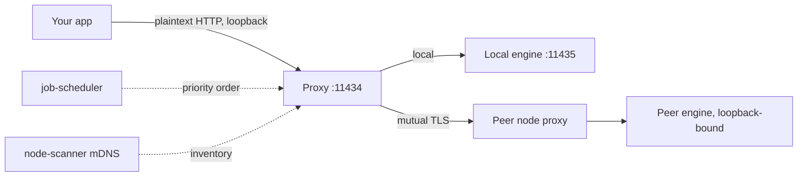

---
# ─── Identity ───────────────────────────────────────────────
type: product-research
product: "Personal AI Router"
vendor: "NVIDIA"
aliases: ["PAIR", "nvpair", "NVIDIA PAIR"]
url: "https://www.nvidia.com/en-us/ai-on-rtx/personal-ai-router/"
docs: "https://docs.nvidia.com/local-ai/nvpair/"
repo: "https://github.com/NVIDIA/Personal-AI-Router"

# ─── Classification ─────────────────────────────────────────
category: "local-inference-routing"
deployment: "self-hosted"
license: "Apache-2.0"
pricing-model: "free"

# ─── Assessment ─────────────────────────────────────────────
status: "researching"
verdict: "trial"
confidence: "medium"
maturity: "beta"

# ─── Provenance ─────────────────────────────────────────────
researched: 2026-09-13
updated: 2026-09-13
version-reviewed: "0.1.1"
researcher: "agent"

tags: [research/product, category/local-inference-routing, status/researching, verdict/trial]
---

# NVIDIA — Personal AI Router

> [!abstract] One-liner
> Free, Apache-2.0 software that puts every Ollama or LM Studio machine on your LAN behind one loopback endpoint and routes each inference request to whichever node can serve it.

## Summary

- **What:** A peer-to-peer local inference router. Install on each machine, pair them, and applications keep talking to `127.0.0.1:11434` while requests land on whichever node has the model and the least queued work.
- **How it works:** No controller. Every node runs the same 13 Go services, discovers peers over mDNS, and carries routed inference between machines over mutual TLS with pinned self-signed certificates.
- **Why it matters here:** It targets the multi-agent bottleneck specifically — a lead agent fanning out to subagents becomes dozens of independent model calls, which is exactly the shape of workload that saturates one GPU.
- **Effort to adopt:** Minutes per machine. Installers for Windows, Debian, and macOS; the engine and model downloads are driven from the UI.
- **Verdict:** Trial for personal multi-machine use. Not a candidate for enterprise deployment at v0.1.1 — see Risks.

## What It Is

NVIDIA Personal AI Router (PAIR) is a local inference router for a group of compatible computers on the same network. It discovers nodes, manages Ollama and LM Studio, and presents Ollama-compatible and OpenAI-compatible proxy endpoints to applications and agents. It was announced at IFA in early September 2026 and is in public beta.

The product is free and open source under Apache 2.0, with no paid tier, no account, and no cloud service component. The reviewed version is **0.1.1**, released 28 August 2026 — a build-tooling fix that NVIDIA states is functionally identical to 0.1.0 for anyone installing it. Two releases total, and the repository is young.

NVIDIA's framing is that most households have more than one PC and most of that silicon is idle most of the day. The design consequence matters more than the pitch: PAIR increases how many requests you can run **at once**. It does not make any individual request faster.

## Problem It Solves

A single machine running local models serializes under concurrency. Agentic workloads make this acute — one user-visible task becomes dozens of independent model calls as a lead agent delegates to subagents, and they all queue on one GPU.

The alternative without PAIR is manual: run engines on several machines, expose them on the network, and teach every client which host has which model. That means reconfiguring clients, and it means engines listening on the LAN. PAIR removes both by keeping the client's base URL unchanged and keeping the engines bound to loopback.

## How It Works

### Architecture

There is no server, controller, or primary node. Every node runs the same software and can both serve requests and route them elsewhere. Control traffic and inference traffic follow separate paths.

On each node, Electron (or the terminal interface on headless boxes) starts `nvpair-ui-broker`, which supervises the worker processes and exposes a JSON-RPC API. The Go tree produces 13 build outputs, including `ollama-proxy` and `lmstudio-proxy`, `nvpair-node-scanner` for discovery, `nvpair-cluster-manager` for identity and pairing, `nvpair-engine-manager` for engine lifecycle, and `nvpair-job-scheduler` for priority ordering.

The broker relays to workers over stdio on the same machine only — it is not a cluster transport. Peer nodes call each other's HTTP services directly.



### Core Concepts

| Term | Means | Notes |
|---|---|---|
| Node | One machine running PAIR | Belongs to at most one cluster; must leave before joining another |
| Cluster | The set of paired nodes | Membership is symmetric; no founder |
| Engine | Ollama or LM Studio on a node | PAIR can install, start, stop, update — or adopt one you already run |
| Model | Belongs to an engine on a specific node | Nothing is shared; the same model on two nodes is two independent copies |
| Endpoint | The local URL apps use | One per engine, unchanged regardless of which node serves |
| Proxy | What sits behind an endpoint | Accepts, picks a node, forwards, streams back |
| Job | One routed request | Called a *workload* in logs and component names |
| Broker | Parent service on each node | Supervises workers, exposes JSON-RPC |

### Data Flow

An application sends an ordinary Ollama- or OpenAI-style HTTP request to the local proxy. The proxy builds an **ordered failover list** rather than picking one winner, then walks it.

Eligibility is a hard gate — a node qualifies only if it is reachable, running an engine that can serve the request, and advertising the requested model in its current inventory. Among eligible owners the order is: a manually pinned node, then the scheduler's priority order, then remaining nodes by stable node ID so cold start is deterministic rather than random.

The scheduler ranks by pending work plus coarse GPU pressure — smoothed utilization mapped to 0–3 units at 40%, 70%, and 85% thresholds, with lower thresholds on the way down to avoid rank thrash. Telemetry that is missing or older than ten seconds counts as neutral pressure rather than idle. Each proxy also counts what it just dispatched itself, so a concurrent burst spreads instead of piling onto the same apparently-idle node.

Model listings are not routed at all: a `GET` of `/v1/models` or `/api/tags` is fanned out to every candidate and the replies merged, which is why the answer is the cluster's inventory rather than one node's.

If an advertised owner answers inference with `404`, its inventory was stale and the proxy fails over to the next owner. Genuine client errors like `400` or `422` are not retried, because they would fail identically everywhere.

### Integration Surface

| Surface | Detail |
|---|---|
| Ollama endpoint | `http://127.0.0.1:11434` — serves `/api/chat`, `/api/generate`, `/api/embed`, `/api/tags`, plus OpenAI-compatible `/v1/*` |
| LM Studio endpoint | `http://127.0.0.1:1234` — OpenAI-compatible paths only |
| `OLLAMA_HOST` | A loopback value is honored and served; remote or HTTPS targets are left alone |
| Control API | Broker JSON-RPC, documented in the repo; the desktop app and TUI are both clients |
| Clients | Anything that lets you set a base URL and model name |

### Two Personalities on One Port

Worth its own note because it explains most of the surprising behavior. The proxy and cluster manager serve two protocols on one port, chosen by the connection's first byte — a TLS record starts with `0x16` and no HTTP method does. Plaintext gets loopback only; `0x16` gets mutual TLS from paired nodes.

The listener binds all interfaces so the TLS personality can accept peers, but plaintext from any non-loopback address is refused with `403`. Without that check the port would be an open relay for anything on the network.

## Capabilities

| Capability | Supported | Notes |
|---|---|---|
| Route across mixed-OS nodes | ✅ | Windows, Linux, macOS nodes pair with each other |
| Existing clients work unchanged | ✅ | Proxy takes the engine's usual port; engine moves up one |
| Install/manage engines | ✅ | Or adopt an engine you installed yourself |
| Encrypted node-to-node inference | ✅ | Mutual TLS, certificates pinned at pairing |
| Model-aware routing | ✅ | Hard eligibility gate on advertised inventory |
| GPU-aware load ordering | ⚠️ | Coarse: utilization only, never VRAM or GPU model |
| Headless operation | ⚠️ | TUI exists but cannot do everything the desktop can |
| Pin a request to a node | ⚠️ | TUI **Proxies** tab only; the desktop app never pins |
| Network-reachable endpoint | ❌ | Refused by design, with no plan to add it |
| Pool VRAM / shard a model | ❌ | Explicitly out of scope |

### What It Does Well

Transparency to existing clients is the strongest design choice. Port takeover means tools already pointed at `11434` gain the cluster without being touched. Engines PAIR starts bind to loopback, so the only network-facing listener is the proxy, which is where cluster authentication lives.

The documentation is unusually candid. The Architecture page states scheduler limitations plainly rather than burying them, including that a node running one enormous request looks more idle than a node running two trivial ones.

Deference to existing state is well handled: if something already serves an engine's port, PAIR adopts it rather than spawning a second copy — and then refuses operations needing process ownership rather than faking them. Changing the port of an adopted engine returns an error instead of leaving two listeners.

### What It Does Not Do

- No GPU memory pooling and no combining GPUs into one larger logical GPU.
- No splitting a model or an in-flight request across machines. Each request runs whole on one node.
- No migrating a running request to a different node.
- No model storage or serving of its own — engines fetch and hold their own.
- No remote management: you update each machine from that machine, and a node cannot be driven remotely.
- A peer request is served, never re-routed onward, so a node cannot chain a request through a third node.

## How To Use It

### Prerequisites

One machine is enough to run inference; two or more on the same LAN to see routing. Nothing else needs to be in place — PAIR installs the engine and downloads models for you.

| | |
|---|---|
| OS | Windows 11, Linux, macOS |
| Arch | x64 and arm64 on all three; Windows on ARM is experimental |
| Installers | Windows `.exe`, Linux `.deb`, macOS `.dmg`; other distros build from source |
| Engines | Ollama, LM Studio |

PAIR running on a machine does not mean an engine will. Each engine sets its own OS, GPU, and driver requirements, and each model needs enough memory to load.

### Quickstart

1. Download from the [releases page](https://github.com/NVIDIA/Personal-AI-Router/releases) and install. On Linux: `sudo apt install ./NVPAIR-Setup-*.deb`
2. Launch. First-run setup offers to install an engine; Ollama is the default where available.
3. Pair a second machine: **Add node** in the toolbar, pick the discovered system, and enter the six-digit PIN shown on the inviting machine.
4. On each node, expand **Engine settings**, start the engine, and **Add model**.
5. Copy the URL from **Endpoints** — do not type a port from memory.
6. Send a request:

```bash
curl <PAIR_BASE_URL>/v1/chat/completions \
  -H "Content-Type: application/json" \
  -d '{"model":"<MODEL_NAME>","messages":[{"role":"user","content":"In one sentence, what does a router do?"}]}'
```

7. Open **Overview**, filter to **Jobs**, and read **Ran on** to confirm where it went.

### Common Workflows

- **Watch routing without writing a client:** **Test** on **Settings → Service** runs a sixty-second synthetic burst that appears as ordinary job activity. It is a traffic generator, not a benchmark — no score, no prompts logged.
- **Prove cluster routing, not just local serving:** put a model on one *other* node only, request it locally, and check that **Jobs** names the other machine.
- **Query what the cluster can serve:** `curl <PAIR_BASE_URL>/v1/models` returns the merged inventory across nodes.
- **Drive an engine's own CLI:** set `OLLAMA_HOST` to the engine's real port (`11435` by default). Otherwise the CLI hits the proxy on `11434` and `ollama list` returns the cluster's view instead of the local machine's.

### CLI / API Reference Highlights

| Thing | Purpose | Gotcha |
|---|---|---|
| `/v1/chat/completions` | Works with either engine | The safe default for any client |
| `/api/chat` | Ollama style | Fails against the LM Studio endpoint |
| `/v1/models` | Cluster inventory | Fanned out and merged, not routed |
| Ollama binary path | `%LOCALAPPDATA%\Nvidia Corporation\Personal AI Router\engine-bin\...` (Win) | Not on `PATH`; on Linux needs `LD_LIBRARY_PATH` set to its bundled `lib/ollama` |

## Implementation Guide

### Deployment Options

| Option | Best for | Trade-offs |
|---|---|---|
| Released installer | Everyone | Signed, adds Windows firewall rules, checks for updates |
| Build from source | RPM distros, contributing | Unsigned, no update feed, upgrade by `git pull` and rebuild |
| Services archive + TUI | Headless nodes | No desktop app; several operations unavailable |

### Reference Architecture

Install PAIR on the machine you actually work at and point your applications at *its* local endpoint. That machine needs no GPU and no engine of its own — only cluster membership. Its proxy routes on your behalf.

This is not optional cleverness; it is the only shape that works. An endpoint accepts requests from its own machine only. A fourth machine cannot point at `http://some-node:11434` — it has no loopback path and no pinned certificate. If you need a network-reachable inference endpoint, that is outside what PAIR does, and NVIDIA states there is no plan to add it, because it would turn any node into an open relay.

### Configuration

| Setting | Default | Recommended | Why |
|---|---|---|---|
| Ollama proxy port | `11434` | Leave | Existing clients keep working |
| LM Studio proxy port | `1234` | Leave | Same |
| Engine port | `11435` / `1235` | Leave | Set `OLLAMA_HOST` here for direct CLI access |
| Model placement | — | Duplicate hot models on ≥2 nodes | One copy means no balancing for that model |

Peer ports, which must be reachable between nodes but are never connected to directly: `5353/udp` (mDNS discovery), `14318` (node and model inventory), `14319` (error sync), `14320` (workload propagation), `14321` (pairing and membership), `14322` (model list to peers), `14323` (remote engine control).

### Rollout Plan

| Phase | Scope | Exit criteria |
|---|---|---|
| 0. Single node | One machine | Engine running, `/v1/models` answers, a job appears under **Jobs** |
| 1. Pair | Two machines | Model on the *peer only* is served, **Jobs** names the peer |
| 2. Load | Real agent workload | Concurrent subagent calls visibly spread across nodes |
| 3. Steady state | All nodes | Every node on the same version |

Rollback is clean. Uninstalling keeps your data by default; `--purge` or `sudo apt purge nvpair` removes settings, logs, cluster identity, certificates, and PAIR-installed engines. **Model weights are never touched** — they live in the engine's own storage. Leave the cluster first (**Settings → Cluster → Leave**), or remove the node from any other member afterwards.

## Security & Compliance

This is the section that decides whether PAIR belongs on a given network.

- **Trust bootstrap:** discovery is deliberately *not* a trust decision — every machine on the network is visible. Pairing is, and it is explicit and mutual. NVIDIA is direct that the six-digit PIN is a convenience code for bootstrapping, not a strong authenticator, and that pairing itself happens in plaintext because no trust exists yet at that point.
- **Node-to-node transport:** mutual TLS for inventory, workloads, errors, membership, remote engine control, and routed inference. Each node holds a stable UUID and a self-signed leaf certificate; pairing pins each side's certificate against the other's UUID.
- **The unauthenticated surface:** host and GPU telemetry is plaintext HTTP and **not authenticated**, on a clustered node as much as an unclustered one. NVIDIA calls this a considered trade-off and states the consequence plainly — hostname, hardware inventory, and utilization are readable by anything on the same subnet that asks. Their own guidance: do not run PAIR on a network where that is unacceptable.
- **Local surface:** proxies serve plaintext to loopback only, enforced with a `403` for non-loopback plaintext.
- **Data handling:** prompts and responses are intended to stay on the local network when every client, model source, engine, and node is local. No vendor telemetry path is described.
- **Supply chain:** Apache 2.0, public repo, published SHA-256 for every release asset, signed installers, a security policy with private disclosure, and third-party notices for bundled dependencies.
- **Attestations:** none — not that kind of product. No SOC 2, no ISO, no DPA.
- **Known CVEs:** none found as of 2026-09-13.

Two boundaries NVIDIA names that are easy to miss: broker JSON-RPC has no independent per-message token, relying on stdio's single parent peer or OS endpoint permissions; and the cluster boundary protects cluster-scoped workers and promoted proxy ingress, not every local or discovery endpoint.

## Operations

- **Health checking is uneven, and documented as such.** There is no `/health` endpoint on any PAIR service and the broker does not heartbeat its workers. Engines get a readiness probe then periodic health probes. Workers get process liveness only — an exit is detected and restarted, **a hang is not**.
- **Restart policy:** exponential backoff from roughly one to sixteen seconds, five attempts per unhealthy streak, and a sixty-second window after which a worker that stayed up is considered recovered.
- **The gap:** a worker that is running but wedged holds its stdio pipe and stops answering. Nothing detects that today. The symptom is state that quietly stops updating; the fix is restarting from **Settings → Service**.
- **Peer liveness:** the scanner scans every five seconds and tolerates three consecutive misses, then checks recent inference, recent telemetry, and direct probes before evicting — deliberately avoiding the proxy ports so liveness tests never land on the serving path.
- **Updates:** checked shortly after start and every six hours, but never downloaded or installed without you asking. Settings, logs, cluster identity, and membership survive an update. **Update every node to the same version** — a mixed-version cluster is untested and treated as unsupported.
- **Day-2 toil:** low, but manual. Per-machine updates, no remote management, and model placement is a decision you own.

## Licensing & Cost

Free. Apache 2.0. No editions, no tiers, no account, no telemetry-for-features bargain. Inference engines, models, and other software used with PAIR carry their own terms.

The real cost is hardware you already own plus the electricity to keep it awake.

## Alternatives & Comparison

| | PAIR | Olla / llama-swap | exo / MLX Distributed |
|---|---|---|---|
| What it routes | Independent requests across nodes | Requests across backends, model swapping | One model sharded across machines |
| Discovery | Automatic mDNS + manual | Config file | Automatic |
| Inter-node transport | Mutual TLS, pinned certs | Plain HTTP to configured endpoints | Varies |
| Engines | Ollama, LM Studio only | Many | Its own runtime |
| Lock-in | None (Apache 2.0) | None | None |

The distinction that matters: exo and Apple's MLX Distributed shard one model so you can run something too big for any single device. That is model parallelism and it is complementary rather than competing — a distributed cluster can sit behind a request router as one powerful node. PAIR does request routing and says so explicitly.

Against generic proxies like Olla or a LiteLLM/llama-swap stack: those route more backend types and are configured rather than discovered. PAIR buys you zero-config discovery, mutual TLS between nodes, and engine lifecycle management, at the cost of supporting exactly two engines. If your fleet is already Ollama and LM Studio, PAIR is less assembly. If you run vLLM or llama.cpp directly, PAIR cannot route to them at all.

## Evaluation

### Fit

Fits the personal/home-lab case it was built for: several machines, agentic workloads that fan out, and a preference for keeping prompts off other people's infrastructure. The macOS-plus-NVIDIA pairing is the interesting part — a Mac that runs agents can borrow an RTX box's GPU without the agent framework knowing anything changed.

Does not fit an enterprise deployment. There is no central management, no fleet policy, no audit trail beyond local logs, no SSO or RBAC of any kind, and the trust model is a six-digit PIN typed by a human. The unauthenticated telemetry endpoint alone would be hard to defend on a corporate subnet, and NVIDIA does not ask you to defend it — they tell you not to run it there.

### Risks & Limitations

| Risk | Likelihood | Impact | Mitigation |
|---|---|---|---|
| Telemetry readable by anything on the subnet | Certain | Medium | Trusted network segment only |
| PIN-based pairing on a shared network | Situational | High | Pair only on trusted networks |
| Wedged worker goes undetected | Medium | Medium | Watch for state that stops updating; restart the service |
| Routing favors a slower GPU | Medium | Low | Same utilization means the same pressure on a small and a large GPU |
| Cold-load penalty | Medium | Low | Eligibility asks whether a node *has* a model, never whether it is loaded |
| Ollama desktop app steals `11434` | Medium | Low | PAIR yields; requests reach local Ollama unrouted and **Jobs** stays empty |
| v0.1.1 maturity | Certain | Medium | Two releases, 3 open issues, weeks old |

Unified-memory systems also report misleading GPU memory: correct on Grace-Blackwell including DGX Spark, understated on Windows integrated GPUs, missing on Linux without an NVIDIA driver. The impact is display rather than routing, since routing never considers VRAM — but it misleads *you* when deciding which node should hold a large model.

### Open Questions

- [ ] What hardware would actually be in the cluster here? PAIR's value is proportional to idle GPUs, and a single-machine install buys nothing.
- [ ] Does the mixed-cluster scheduling weakness matter in practice, or does model placement route around it?
- [ ] How does an agent framework behave when a `502 no available node advertises the requested model` arrives mid-run?
- [ ] Does the TUI's inability to show which node served a workload make headless nodes hard to operate?
- [ ] Release cadence after the IFA launch — two releases three days apart, then nothing for two weeks. Too early to read.

## Verdict

**Trial**, for personal multi-machine local inference where the LAN is trusted. The design is coherent, the documentation is honest about its own gaps, the license is clean, and the cost of trying it is an installer and twenty minutes. **Avoid** on any corporate or shared network at this version — unauthenticated host telemetry and PIN-bootstrapped trust are stated design positions, not bugs awaiting a fix.

Confidence is medium: everything here comes from vendor documentation and the repository, with no hands-on validation and almost no independent operational reporting yet, which is expected for something two weeks old.

## References

1. [PAIR Overview](https://docs.nvidia.com/local-ai/nvpair/) — vendor docs, accessed 2026-09-13
2. [Getting Started](https://docs.nvidia.com/local-ai/nvpair/getting-started) — vendor docs, accessed 2026-09-13
3. [Architecture](https://docs.nvidia.com/local-ai/nvpair/architecture) — vendor docs, accessed 2026-09-13
4. [Known Issues](https://docs.nvidia.com/local-ai/nvpair/known-issues) — vendor docs, accessed 2026-09-13
5. [Repository README](https://github.com/NVIDIA/Personal-AI-Router/blob/main/README.md) — accessed 2026-09-13
6. [Releases](https://github.com/NVIDIA/Personal-AI-Router/releases) — v0.1.1, 28 Aug 2026, accessed 2026-09-13
7. [PAIR virtual inference router](https://developer.nvidia.com/blog/nvidia-pair-virtual-inference-router-expands-available-compute-on-your-local-network/) — NVIDIA technical blog, accessed 2026-09-13
8. [Product page and FAQ](https://www.nvidia.com/en-us/ai-on-rtx/personal-ai-router/faq/) — vendor marketing, accessed 2026-09-13
9. [XDA hands-on](https://www.xda-developers.com/connected-two-pcs-one-ai-endpoint-nvidia-new-router-serving-engine/) — third party, accessed 2026-09-13
10. [Olla comparison guide](https://thushan.github.io/olla/compare/overview/) — third party, accessed 2026-09-13

## Related Notes

- [[local-ai]]
- [[Ollama]]
- [[LM Studio]]
- [[DGX Spark]]

## Changelog

| Date | Change | By |
|---|---|---|
| 2026-09-13 | Initial research note, v0.1.1 | agent |
