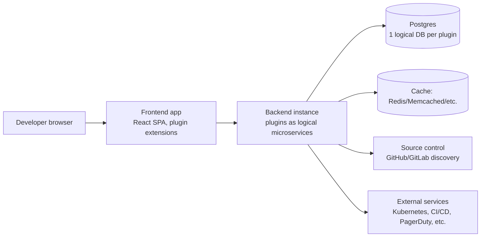

---
# ─── Identity ───────────────────────────────────────────────
type: product-research
product: "Backstage"
vendor: "Spotify (donated to CNCF); commercial hosting by Spotify (Portal) and Roadie; enterprise distribution by Red Hat (Developer Hub)"
aliases: ["Backstage.io", "CNCF Backstage", "Spotify Portal for Backstage", "Red Hat Developer Hub", "RHDH"]
url: "https://backstage.io/"
docs: "https://backstage.io/docs/overview/generated-index/"
repo: "https://github.com/backstage/backstage"

# ─── Classification ─────────────────────────────────────────
category: "Internal Developer Platform (IDP) / Developer Portal & Software Catalog"
deployment: "self-hosted (open source) | hybrid (RHDH on OpenShift) | SaaS/managed (Spotify Portal, Roadie)"
license: "Apache-2.0 (core project and RHDH); Spotify Portal and Roadie are proprietary hosted offerings built on it"
pricing-model: "free (self-hosted) | per-seat/subscription (Roadie, Spotify Portal) | subscription (RHDH via Red Hat/OpenShift entitlement)"

# ─── Assessment ─────────────────────────────────────────────
status: "researching"
verdict: "trial"
confidence: "medium"
maturity: "ga"

# ─── Provenance ─────────────────────────────────────────────
researched: 2026-09-13
updated: 2026-09-13
version-reviewed: "v1.54.6 (self-hosted core, Aug 2026); Red Hat Developer Hub 1.5 referenced for enterprise distribution"
researcher: "agent"

tags: [research/product, category/developer-portal, status/researching, verdict/trial]
---

# Spotify — Backstage

> [!abstract] One-liner
> Backstage is Spotify's open-source (now CNCF-incubating) framework for building an internal developer portal on top of a centralized software catalog, used here as a reference point for evaluating and informing the team's own "Foundation" developer portal.

## Summary

- **What:** An open-source framework (not a turnkey SaaS product) for assembling an internal developer portal — a software catalog, a documentation hub, a scaffolder for new services, and a plugin system to bolt on everything else (Kubernetes, CI/CD, cost, security findings).
- **How it works:** A React frontend and a Node.js/TypeScript backend, both structured as a core "app" wired together from first-party and community plugins; state lives in Postgres (or SQLite for dev); entities are described in `catalog-info.yaml` files discovered from source control (GitHub, GitLab, etc.).
- **Why it matters here:** It's the de facto reference architecture for the exact problem the team's "Foundation" portal (React/CloudFront, AppSync GraphQL + API Gateway REST, Lambda, Neptune, CDK) is solving — a service catalog with ownership, relationships, and a graph-shaped data model — and Red Hat's distribution (RHDH) is directly relevant given the team's ROSA footprint.
- **Effort to adopt:** Non-trivial if self-hosted from scratch (2–4 platform engineers commonly cited for year one); materially lower if consumed via RHDH on existing OpenShift/ROSA infrastructure, or via a managed SaaS (Spotify Portal, Roadie).
- **Verdict:** Worth a hands-on trial as a comparison point and possible plugin-ecosystem donor for Foundation, not a drop-in replacement — the team already owns a working, differently-shaped data model (Neptune graph) that Backstage's catalog would either duplicate or need to be fed by.

## What It Is

Backstage is an open framework, originally built internally at Spotify and open-sourced in 2020, for building internal developer portals. It was accepted into the CNCF Sandbox in September 2020 and promoted to CNCF Incubating status in March 2022, where it remains as of this research; it has not yet reached CNCF Graduated. The project is Apache-2.0 licensed, developed as a large TypeScript/JavaScript monorepo on GitHub, and reports over 34,000 GitHub stars, 7,500+ forks, and (per CNCF's own metrics dashboard) more than 8,200 contributors from over 1,700 contributing organizations — a strong adoption signal for a project whose actual runtime footprint is "code you assemble and run yourself," not a hosted product.

It is important to scope which "edition" is being discussed, because there are effectively three ways to consume it, with very different cost and support profiles:

1. **Upstream/self-hosted Backstage** — the free, open-source framework, run and operated entirely by the adopting team.
2. **Red Hat Developer Hub (RHDH)** — Red Hat's curated, commercially supported distribution of Backstage (also Apache-2.0), pre-integrated with 24+ plugins (ArgoCD, Kubernetes, Tekton, Quay, GitHub, GitLab, Keycloak, PagerDuty, SonarQube, etc.), sold and supported as part of the OpenShift ecosystem.
3. **Managed SaaS** — Spotify's own "Portal for Backstage" (a "managed, no-code" hosted product built on Backstage, adding an AI Gateway and fleet-scale governance features) and third-party hosts such as Roadie, who run and upgrade Backstage on the customer's behalf.

This note treats upstream/self-hosted Backstage as the primary subject, with RHDH and the SaaS options covered under Alternatives, since RHDH in particular is a realistic adoption path given the team's existing ROSA (OpenShift) investment.

## Problem It Solves

At any organization running more than a handful of services, engineers lose time answering three recurring questions: what services exist and who owns them, how do I create a new one that follows the golden path, and where is the documentation for the thing I just found. Without a catalog, that knowledge lives in spreadsheets, wiki pages, tribal memory, and Slack threads that go stale immediately. Backstage's stated goal is to "restore order" to this sprawl by making the catalog the source of truth that other tools (CI/CD, Kubernetes, cost, security) attach metadata to, and by giving teams a paved-road scaffolder so new services start compliant rather than needing retrofitting. The realistic alternative most organizations default to is exactly what "Foundation" is: a purpose-built internal application that models the same ownership/relationship/discovery problem directly against the org's own systems (GitHub, ROSA, Neptune) rather than adopting an external framework's opinions about how a catalog should be shaped.

## How It Works

### Architecture

Backstage ships as two cooperating systems: a **frontend app** (a React single-page app that is a thin shell wiring together UI plugins) and a **backend system** (a Node.js process, or set of processes, wiring together backend plugins). Both are "deployment units" assembled from an ecosystem of plugins rather than a monolith with fixed features.

- **Frontend**: the app composes "extensions" (visual and non-visual building blocks) from plugins into a single tree; each plugin claims a URL path (e.g., the catalog lives at `/catalog`); plugins interoperate through typed "Utility APIs" and a routing abstraction.
- **Backend**: backend plugins run as independent logical services within one or more backend processes and only talk to each other over the wire (no direct in-process calls), which keeps plugins swappable and independently scalable. "Modules" extend a plugin via its declared Extension Points (for example, adding a new Catalog Entity Provider or a new Scaffolder Action) but must run in the same backend instance as their parent plugin.
- **State**: Backstage uses the Knex query builder, with **one logical database per plugin**; Postgres is the supported production database, SQLite is dev/test-only. An optional cache layer (in-memory, Memcached, Redis, Valkey, or Infinispan) sits in front of expensive plugin operations, again logically separated per plugin.



### Core Concepts

| Term | Means | Notes |
|---|---|---|
| Software Catalog | The central registry of entities (services, APIs, resources, teams) | The system of record everything else attaches to |
| Entity | One catalog record, described by a `catalog-info.yaml` | Kinds: Component, API, Resource, System, Domain, Group, User, Location, Template |
| Location | A pointer to where an entity descriptor file lives | Used for manual registration; discovery providers replace most manual Locations |
| Entity Provider / Processor | Backend code that discovers or enriches entities | E.g., the GitHub Discovery provider crawls an org for `catalog-info.yaml` |
| TechDocs | Docs-as-code: Markdown in the repo, rendered in the portal | Built on MkDocs under the hood |
| Software Templates (Scaffolder) | Golden-path templates that generate new repos/components | Analogous to an internal "create-service" wizard |
| Plugin | A packaged unit of frontend and/or backend functionality | Typically ships as ~5 npm packages (frontend, backend, common/isomorphic) |
| Extension Point | A plugin's declared customization hook | What Modules attach to |
| Permission Framework | The authorization layer plugins call into | Supports RBAC, ABAC, or fully custom policy code |

### Data Flow

A typical request: a developer's browser hits the frontend app, which calls the backend's catalog plugin over its REST API; the catalog plugin serves from its Postgres tables, which were populated on a refresh cycle by an Entity Provider (e.g., GitHub Discovery) that scanned the configured GitHub organization for repositories containing a `catalog-info.yaml` matching a glob pattern, parsed and validated each file, and upserted the resulting entities and their relationships (ownedBy, dependsOn, providesApis, etc.) into the catalog's internal graph-like relationship model. Authentication happens up front via a configured identity provider (GitHub, Google, Okta, SAML/OIDC, or a proxy such as Cloudflare Access); a signed-in session then carries short-lived, delegated OAuth tokens that plugins use to call out to GitHub, Kubernetes, or other backing services on the user's behalf.

### Integration Surface

Backstage integrates primarily through its own plugin architecture rather than a single external API surface: frontend and backend plugins are TypeScript packages; backend plugins expose REST endpoints; the catalog has entity-provider hooks for pulling in external inventory (GitHub, GitLab, Azure DevOps, Kubernetes, cloud resource APIs); the Scaffolder exposes custom "actions"; and third-party services are typically reached either directly from a backend plugin or via Backstage's built-in proxy (to route around browser CORS restrictions) for frontend-initiated calls. There is no first-party Terraform provider or CLI beyond `@backstage/cli` (used for local dev/build) and the app generator `@backstage/create-app`.

## Capabilities

| Capability | Supported | Tier | Notes |
|---|---|---|---|
| Software catalog (services, APIs, resources, teams) | ✅ | OSS | Core plugin, YAML-defined |
| Automatic discovery from GitHub/GitLab/Azure DevOps | ✅ | OSS | Via Entity Provider plugins; GitHub Enterprise supported via `host` config |
| Golden-path scaffolding (new-service templates) | ✅ | OSS | Scaffolder plugin |
| Docs-as-code (TechDocs) | ✅ | OSS | MkDocs-based |
| Kubernetes visibility | ✅ | OSS | Official Kubernetes plugin |
| Cross-catalog search | ✅ | OSS | Search plugin, pluggable backends |
| Fine-grained RBAC UI (no-code role management) | ⚠️ | RHDH / Spotify Portal | OSS ships a permission *framework*, not a turnkey RBAC admin UI |
| Managed hosting / upgrades | ⚠️ | Roadie, Spotify Portal | Not part of OSS; you operate it yourself otherwise |
| AI-assisted catalog/plugin features | ⚠️ | Spotify Portal | "AI Gateway" is a Portal-specific addition, not in OSS core |
| SOC 2 / enterprise compliance attestation | ⚠️ | Spotify Portal (claims SOC 2) | Not applicable to self-hosted OSS — that's on you |
| Native graph-query interface over catalog relationships | ❌ | — | Catalog models relationships, but there's no exposed graph query language (e.g., no openCypher-equivalent) — a point of contrast with Foundation's Neptune backend |

### What It Does Well

Backstage's strongest, most independently corroborated strength is the catalog + discovery + TechDocs combination: it gives an org a single, git-native way to declare what a service is, who owns it, and where its docs live, and it back-fills that catalog automatically from existing repos rather than requiring a parallel manual inventory process. The plugin ecosystem (thousands of community plugins, plus RHDH's curated 24+) means most common integrations (Kubernetes, ArgoCD, SonarQube, PagerDuty) already have a plugin rather than needing custom build-out.

### What It Does Not Do

It is not a hosted product out of the box — "self-hosting Backstage" means owning Node.js/Postgres operations, plugin upgrades, and a release cadence that ships monthly with weekly pre-releases, indefinitely. It does not ship a polished, no-code RBAC administration experience in the open-source core — that exists as a first-class feature specifically in RHDH and in Spotify's commercial Portal, not upstream. It has no native equivalent to a property-graph query interface; catalog relationships are modeled and traversable through its own API/UI, but there's no exposed query language comparable to what a team already running entities in Neptune has via openCypher/Gremlin.

## How To Use It

### Prerequisites

- Node.js Active LTS (22 or 24 recommended), Yarn 4.4.1 (via Corepack), a GNU-like build toolchain (`build-essential` / Xcode CLT), Docker, and Git.
- Minimum ~20 GB free disk and 6 GB RAM for local development.
- Unix-like OS (Linux, macOS, or WSL on Windows).

### Quickstart

```bash
# 1. Scaffold a new Backstage app
npx @backstage/create-app@latest
# prompted for an app name, e.g. <my-backstage-app>

# 2. Run it locally
cd <my-backstage-app>
yarn start
```

Success looks like an "Rspack compiled successfully" message and a working demo instance reachable at `http://localhost:3000`, pre-wired with the catalog, TechDocs, Scaffolder, and Search plugins against sample data.

### Common Workflows

- **Register a service**: add a `catalog-info.yaml` to a repo (or let GitHub Discovery pick it up automatically on its refresh interval, default 35 minutes) to have it appear in the catalog with its declared owner and relationships.
- **Create a new service from a template**: use the Scaffolder UI to run a Software Template, which generates a new repo from a skeleton and variables and registers it in the catalog.
- **Read a service's docs**: open its catalog entry's TechDocs tab, which renders Markdown committed alongside the code via MkDocs.
- **Check a service's cluster health**: open its catalog entry's Kubernetes tab (requires the Kubernetes plugin configured against the target clusters).
- **Search across everything**: use the Search plugin's cross-catalog search, whose backends and indexed sources are configurable per plugin.

### CLI / API Reference Highlights

| Command / Endpoint | Purpose | Gotcha |
|---|---|---|
| `npx @backstage/create-app@latest` | Scaffold a new Backstage instance | Requires the exact Yarn version pinned by the release you install |
| `yarn start` | Run frontend + backend locally | Needs Docker/Postgres running if not using the SQLite dev default |
| Catalog REST API (`/api/catalog/entities`) | Query/list catalog entities | Auth token required in any non-demo deployment |
| GitHub Discovery `catalogPath` glob | Configure where entity YAML is searched for | Enterprise GitHub requires setting `host` to your GHE hostname |

## Implementation Guide

### Deployment Options

| Option | Best for | Trade-offs |
|---|---|---|
| Self-hosted on Kubernetes (Docker image + Helm/manifests) | Teams that already run Kubernetes and want full control | You own upgrades, scaling, plugin compatibility, and the Postgres instance |
| Red Hat Developer Hub on OpenShift/ROSA | Teams already on OpenShift wanting a supported, pre-integrated distribution | Vendor-curated plugin set and support contract; less flexibility than raw upstream, but directly fits an existing ROSA estate |
| Spotify Portal (managed SaaS) | Teams that want to skip operating Backstage entirely | No-code, hosted, but external dependency and per-seat cost; claims SOC 2 |
| Roadie (managed SaaS) | Similar to Portal — hosted, upgraded, adoption support included | Third-party hosting of your catalog data; pricing not published, quote-based |

### Reference Architecture

For a team in this position (existing ROSA/OpenShift clusters, GitHub Enterprise EMU, and an existing Neptune-backed "Foundation" portal), the two realistic shapes are: (a) run RHDH as an additional workload on an existing ROSA cluster, pointed at GitHub Enterprise via the GitHub Discovery provider (using a GitHub App scoped to the EMU org, not a PAT, for higher rate limits and centralized credential management), backed by a dedicated Postgres instance (RDS or an OpenShift-managed Postgres), with SSO delegated to the org's existing OIDC/SAML IdP; or (b) treat Backstage purely as a reference/plugin-borrowing exercise and continue investing in Foundation, optionally exposing a `catalog-info.yaml`-compatible export from Foundation's Neptune graph so any future Backstage instance could ingest Foundation's data via a custom Entity Provider rather than duplicating discovery logic.

### Configuration

| Setting | Default | Recommended | Why |
|---|---|---|---|
| `catalog.providers.github.<org>.host` | none | Set to your GHE Enterprise hostname | Required for GitHub Enterprise rather than github.com |
| `catalog.providers.github.<org>.catalogPath` | `/catalog-info.yaml` | Glob matching your repo conventions | Controls discovery scope/cost |
| Database | SQLite | Postgres | SQLite is explicitly dev/test-only per docs |
| Auth provider | none configured | Your existing OIDC/SAML IdP | Avoids a second identity silo |
| GitHub auth mechanism | PAT | GitHub App | Higher rate limits, centrally managed, least-privilege (`Contents: Read-only` minimum) |

### Rollout Plan

| Phase | Scope | Exit criteria | Owner |
|---|---|---|---|
| 0. Proof of concept | Local `create-app` instance, GitHub Discovery against one GitHub Enterprise org/team, no production data | Team can see real services auto-discovered in the catalog | Platform team |
| 1. Pilot | RHDH (or upstream) on a non-prod ROSA cluster, Postgres-backed, SSO wired to real IdP | 1–2 pilot teams register real services and use TechDocs/Scaffolder | Platform team + 1–2 pilot service teams |
| 2. Production | Production ROSA deployment, RBAC/permission policy defined, plugin set finalized | Catalog is the org's declared source of truth for service ownership | Platform team |
| 3. Steady state | Ongoing plugin curation, upgrade cadence, catalog hygiene | 15–20% of one engineer's time budgeted for upkeep, per third-party estimates | Platform team |

Rollback: removing Backstage cleanly means decommissioning the Postgres instance and the backend/frontend workloads; the only "data" at risk is the catalog's derived state (all of it is re-derivable from `catalog-info.yaml` files still living in source repos), so rollback risk is low if discovery-based registration was used throughout rather than manual-only entities.

## Security & Compliance

- **Authentication / authorization:** Pluggable sign-in via GitHub, Google, Okta, Azure, GitLab, Auth0, Keycloak, generic OAuth2/OIDC, or SAML; a separate Permission Framework (policy-as-code, supporting RBAC, ABAC, or fully custom logic) governs authorization decisions, with no batteries-included RBAC admin UI in OSS — that's an RHDH/Spotify Portal addition.
- **Secrets handling:** Not centrally documented beyond standard config-file/env-var secret injection; no built-in KMS/HSM integration mentioned in the docs reviewed — treat as an open question.
- **Data handling:** All catalog data is self-hosted (or hosted by whichever SaaS vendor is chosen); no residency/retention specifics found for the OSS core, since that's an operator decision. Spotify Portal claims SOC 2 compliance for its managed offering, per its own marketing pages.
- **Network:** Standard web app ingress/egress; egress requirements depend entirely on which plugins are enabled (e.g., GitHub API, Kubernetes API server, PagerDuty).
- **Audit & logging:** Plugin- and deployment-dependent; no unified audit-log product feature identified in the docs reviewed for OSS core.
- **Attestations:** No SOC 2/ISO/FedRAMP attestation applies to the open-source framework itself (it's code you run); Spotify Portal (the managed SaaS) claims SOC 2 compliance per its own marketing.
- **Supply chain:** Apache-2.0, dependency scanning via Snyk per the project's `SECURITY.md`; vulnerability disclosure goes through Spotify's bug-bounty program and GitHub Security Advisories, with a target of CVE assignment and advisory publication within roughly 72 hours each.
- **Known CVEs or incidents:** CVE-2024-26150 (a 2024 security notice from the Backstage team) and CVE-2024-45815 (prototype pollution, CVSS 6.5) are two identified, disclosed vulnerabilities with public advisories; both were patched in normal releases. This indicates an active, functioning disclosure process rather than an unusually risky product.

## Operations

- **Scaling limits and quotas:** Not fixed by the product — scaling is a function of how the operator sizes the backend and Postgres; the architecture explicitly supports splitting plugins across multiple backend instances for isolation/scaling.
- **Monitoring:** No first-party observability product; operators wire in their own APM/metrics via standard Node.js instrumentation.
- **Failure modes:** A backend plugin outage degrades only that plugin's feature (e.g., TechDocs down doesn't take down the catalog), consistent with the "plugins as independent services" design — but this is a design intent, not independently load-tested by this research.
- **Backup / disaster recovery:** Entirely on the operator; standard Postgres backup practices apply. Because catalog entities are re-derivable from `catalog-info.yaml` in source repos, a full re-discovery is a viable DR path for the catalog plugin specifically.
- **Upgrade and version policy:** Monthly release cycle with weekly pre-releases per Roadie's characterization of the project; third-party cost analysis pegs the ongoing upgrade tax at roughly 15–20% of one platform engineer's time, escalating to 2–3 engineer-months if upgrades are neglected for an extended period.
- **Support model:** Community (Discord, GitHub issues) for OSS; commercial support contracts available via Red Hat (RHDH) or via Roadie/Spotify Portal SLAs.
- **Day-2 toil:** Plugin compatibility churn on upgrade, catalog data hygiene (stale/duplicate entities), and onboarding new teams to the `catalog-info.yaml` convention are the recurring workstreams called out by both the vendor's own hosted-alternative pitch and third-party cost breakdowns.

## Licensing & Cost

Backstage core is free and Apache-2.0 licensed; cost is almost entirely the labor to build, operate, and extend it, not a license fee. A third-party buyer's-guide estimate (not a vendor figure — treat as directional) puts a ~100-engineer org's all-in self-hosted cost at roughly $200k–$1.2M in year one (typical case $450k–$700k), driven 85–92% by 2–4 platform-engineer FTEs, dropping to $250k–$400k/year by year three at 1–2 steady-state FTEs; cloud infrastructure for the app itself was estimated at $15k–$35k/year, a small fraction of the total; custom plugin development was estimated at $20k–$90k per plugin depending on integration depth. These figures are one third-party analyst's model, not verified against any specific deployment, and should be treated as an order-of-magnitude planning input, not a quote.

| Tier | Price metric | Includes | Notable limits |
|---|---|---|---|
| Self-hosted OSS | Free (labor cost only) | Full framework, all OSS plugins | You own all ops, upgrades, and support |
| Red Hat Developer Hub | Included in applicable Red Hat/OpenShift subscription (not independently priced in sources reviewed) | Curated plugin set, vendor support, dynamic plugins | Pricing not published in sources reviewed — verify with Red Hat account team |
| Roadie (hosted) | Not published; quote/free-trial based | Hosted + managed upgrades + adoption support | Third party hosts your catalog data |
| Spotify Portal | Not published in sources reviewed | Managed, no-code, AI Gateway, claims SOC 2 | Vendor lock to Spotify's roadmap for the hosted layer |

For contrast, **Port** (a SaaS-native competitor, not Backstage-based) publishes transparent per-seat pricing: Free (≤15 seats), Basic $30/seat/month (≤50 seats), Standard $40/seat/month (≤200 seats), and custom Enterprise — useful as a cost anchor when comparing "build on Backstage" against "buy a SaaS IDP."

## Alternatives & Comparison

| | Backstage (self-hosted) | Red Hat Developer Hub | Port | Foundation (internal) |
|---|---|---|---|---|
| Deployment | Self-hosted (K8s/Docker) | Self-hosted on OpenShift/ROSA, vendor-supported | SaaS | Self-hosted AWS-native (CDK) |
| Pricing model | Free / labor cost | Red Hat/OpenShift subscription | Per-seat SaaS | Internal build/labor cost |
| Key strength | Huge plugin ecosystem, git-native catalog, CNCF backing | Curated + supported Backstage, fits existing ROSA investment | Fast time-to-value, polished no-code UI, transparent pricing | Already models the org's real graph (Neptune) and integrates with existing AppSync/Lambda stack |
| Key weakness | High self-hosting labor cost, no built-in RBAC UI | Less flexible than raw upstream; cost not publicly transparent | Not built on/interoperable with Backstage's plugin ecosystem; ongoing subscription cost scales with seats | No plugin ecosystem to borrow from; all integrations are bespoke |
| Lock-in risk | Low (OSS, portable data model) | Medium (Red Hat-curated plugin set) | Medium-high (SaaS data + workflow lock-in) | None to a vendor, but full ownership burden stays internal |

Pick self-hosted Backstage when the org wants full control and already has spare platform-engineering capacity to absorb the upgrade/ops tax. Pick RHDH specifically when, as here, OpenShift/ROSA is already the standard runtime and a supported, curated plugin set is preferable to assembling one from the community ecosystem. Pick a SaaS-native tool like Port when speed-to-value and not operating any of it matters more than owning the data model. Continuing to build on Foundation makes sense when the org's actual differentiator is the graph-shaped inventory/relationship model it already has in Neptune — adopting Backstage's catalog would mean either running two catalogs or re-platforming that existing investment onto Backstage's YAML/Postgres model, which is a non-trivial migration, not a swap.

## Evaluation

### Fit

Backstage's core value proposition — a git-native, auto-discovered service catalog with golden-path scaffolding — targets the same "who owns what, and where do I find it" problem Foundation already addresses via a purpose-built AWS/Neptune application. The clearest fit isn't "replace Foundation with Backstage," it's using Backstage (most plausibly via RHDH, given the team's ROSA investment) either as a comparison point for Foundation's own data model and UX, or as a complementary front-end that could eventually surface Foundation's Neptune-backed data through a custom Entity Provider, while borrowing Backstage's plugin ecosystem (Kubernetes, GitHub, PagerDuty, etc.) rather than rebuilding equivalents from scratch. Team skills (React frontend, GraphQL/REST APIs, Node/TypeScript-adjacent stacks, existing GitHub Enterprise EMU governance work) map cleanly onto what Backstage requires operationally.

### Risks & Limitations

| Risk | Likelihood | Impact | Mitigation |
|---|---|---|---|
| Running two parallel "source of truth" catalogs (Foundation + Backstage) causes data drift and team confusion | Medium | High | Decide explicitly which system is authoritative before any pilot; treat Backstage as a consumer of Foundation's data, not a second producer |
| Self-hosting upstream Backstage underestimates ongoing engineering cost | Medium | Medium | Prefer RHDH (vendor-supported) over raw upstream given existing Red Hat/ROSA relationship |
| GitHub Enterprise EMU discovery hits API rate limits at scale | Low-Medium | Medium | Use a GitHub App (not a PAT) for discovery, per Backstage's own guidance |
| No built-in RBAC admin UI in OSS core creates access-control gaps if self-hosted without RHDH/Portal | Medium | Medium | Scope any pilot to RHDH (which ships RBAC) rather than raw upstream if fine-grained access control matters early |

### Open Questions

- [ ] What does an RHDH subscription actually cost against the team's existing Red Hat/OpenShift entitlement — verify directly with the Red Hat account team, since no public price list was found.
- [ ] Could Foundation's Neptune graph be exposed as a custom Backstage Entity Provider, or is the data model too divergent (property graph vs. YAML/relational) to make that clean? Needs a technical spike, not just documentation research.
- [ ] What is Spotify Portal's actual per-seat pricing? Not published in any source reviewed — would need a vendor conversation.
- [ ] Does the team's existing GitHub Enterprise EMU setup have any known constraints on GitHub App creation/installation that would affect the GitHub Discovery provider? Cross-check against the team's own EMU governance notes.

## Verdict

**Trial** — worth a scoped, non-production proof of concept (Phase 0 above) using RHDH against a small slice of the GitHub Enterprise EMU catalog, specifically to evaluate its plugin ecosystem and scaffolding UX as either a complement to or a design input for Foundation, not as a replacement for it. Confidence is medium: the mechanics (architecture, catalog model, deployment options) are well-documented from primary sources, but cost, RBAC-in-practice, and fit against Foundation's existing Neptune-based graph model all remain open questions that only a hands-on pilot or a Red Hat conversation would resolve.

## References

1. [Backstage Software Catalog and Developer Platform — Docs Overview](https://backstage.io/docs/overview/generated-index/) — vendor docs, accessed 2026-09-13
2. [Backstage — Architecture Overview](https://backstage.io/docs/overview/architecture-overview/) — vendor docs, accessed 2026-09-13
3. [Backstage — Descriptor Format](https://backstage.io/docs/features/software-catalog/descriptor-format/) — vendor docs, accessed 2026-09-13
4. [Backstage — Auth](https://backstage.io/docs/auth/) — vendor docs, accessed 2026-09-13
5. [Backstage — Permission Framework Overview](https://backstage.io/docs/permissions/overview/) — vendor docs, accessed 2026-09-13
6. [Backstage — Getting Started](https://backstage.io/docs/getting-started/) — vendor docs, accessed 2026-09-13
7. [Backstage — Deployment](https://backstage.io/docs/deployment/) — vendor docs, accessed 2026-09-13
8. [Backstage — GitHub Discovery](https://backstage.io/docs/integrations/github/discovery/) — vendor docs, accessed 2026-09-13
9. [backstage/backstage — GitHub repo](https://github.com/backstage/backstage) — repo, accessed 2026-09-13
10. [backstage/backstage — Releases](https://github.com/backstage/backstage/releases) — repo/release notes, accessed 2026-09-13
11. [backstage/backstage — SECURITY.md](https://github.com/backstage/backstage/blob/master/SECURITY.md) — repo, accessed 2026-09-13
12. [CVE-2024-26150: Keeping Backstage safe and secure](https://backstage.io/blog/2024/02/28/security-notice/) — vendor blog, accessed 2026-09-13
13. [CVE-2024-45815: Backstage Prototype Pollution](https://www.strix.ai/cve/CVE-2024-45815) — third-party, accessed 2026-09-13
14. [Backstage | CNCF](https://www.cncf.io/projects/backstage/) — CNCF project page, accessed 2026-09-13
15. [Red Hat Developer Hub (RHDH) — GitHub repo](https://github.com/redhat-developer/rhdh) — repo, accessed 2026-09-13
16. [Spotify Portal for Backstage — Docs](https://backstage.spotify.com/docs/portal) — vendor docs, accessed 2026-09-13
17. [Backstage by Spotify — The Ultimate Guide (Roadie)](https://roadie.io/backstage-spotify/) — third-party/vendor, accessed 2026-09-13
18. [Backstage Cost 2026: $200k–$1.2M All-In for a Self-Hosted IDP — PlatformEngineeringCost.com](https://platformengineeringcost.com/backstage-cost) — third-party analysis, accessed 2026-09-13
19. [Plans and Pricing | Port](https://www.port.io/pricing) — vendor pricing page, accessed 2026-09-13

## Related Notes

- [[Internal Developer Platform (IDP) - MOC]]
- [[Foundation - Developer Portal]]
- [[Red Hat Developer Hub]]
- [[GitHub Enterprise EMU Governance]]
- [[Neptune Knowledge Graph]]

## Changelog

| Date | Change | By |
|---|---|---|
| 2026-09-13 | Initial research note | agent |
